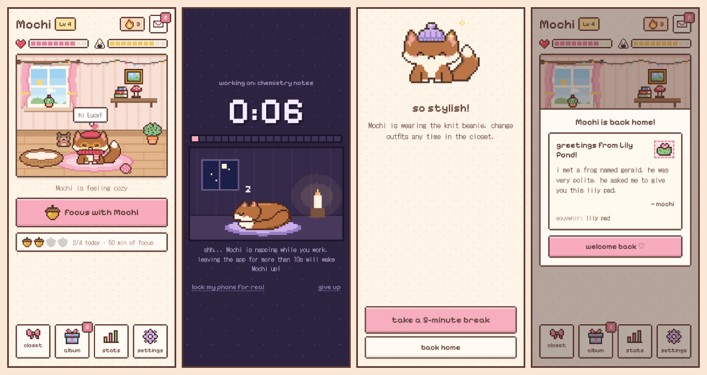
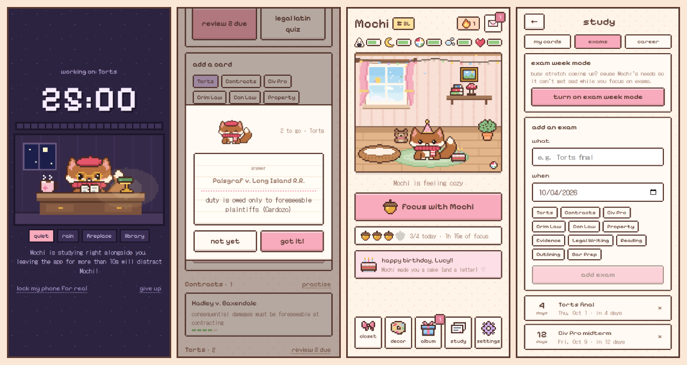

# TamaLucy 🦊

A cozy, pixel-art Tamagotchi (with a little Sims in it) that helps you focus.
A brown fox lives in a tiny room on your phone, walks around, eats, naps and
plays on its own, and wants your attention. Study with it (Pomodoro-style) and
it earns adventures, gifts, treats, clothes and handwritten notes, and climbs a
law career from 1L to the Supreme Court. Stay away too long and it gets hungry,
lonely, and eventually really down.




It's an installable web app (PWA), so it runs on **iPhone and Android** from the
home screen, works offline, and needs no app store.

## What's inside

**Focus timer**
- Pick 10 / 15 / 25 / 45 / 60 minutes (or any length in 5-minute steps), plus an optional "what are you working on?".
- During focus the fox naps in a dim night-light scene, and the screen is kept awake.
- **Leaving the app wakes the fox.** Switch apps for more than the grace period (10s by default) and the session fails and the fox gets sad. A quick accidental swipe is forgiven. There's also a "just pause" mode in settings.
- Built-in guide for locking the phone to the app for real (iPhone Guided Access, Android App Pinning). See [below](#about-you-cant-touch-other-apps).
- **On her Mac** the timer keeps going while she studies in other apps, and a notification calls her back when it's done. See [Focus on a Mac](#focus-on-a-mac).
- **One fox on her iPhone and her Mac**: she signs in with her code and it's the same fox, with the same everything. See [One fox, every device](#one-fox-every-device).
- Optional break timer afterwards.

**Rewards after every session** (pick one; 15+ min gives 3 options to choose from, 45+ min gives two rewards):
- 🎒 **Adventure**: the fox leaves for a few minutes (the length of your break) and comes back with a postcard + souvenir from one of 8 places.
- 🎁 **Gift**: 11 pieces of decor that show up in the room (fairy lights, mushroom lamp that glows at night, teddy bear, heart rug...).
- 🍓 **Treat**: 8 snacks that fill the tummy. The fox secretly has two favourites to discover.
- 🎀 **Clothes**: 11 outfits (frog hat, strawberry hat, beret, flower crown, heart shades, scarf...). Mix and match in the closet.
- 💌 **Note**: the fox writes you a little letter. ~40 notes, some depending on time of day, session length and your streak.

**Acorns: studying is how she looks after the fox**
- Focusing earns acorns: 1 for every 5 minutes (a 25-minute session = 5), shown
  in the top bar and on the reward screen.
- Looking after the fox costs them: a portion of food 1 (so refilling an empty bowl
  is 3), a bath 2, and brushing, cuddles, chats, dancing, tag, ball or yarn 1 each.
  The pie menus show the price, and if she's short, the fox suggests focusing together.
- Always free: petting, naps, treats she's already won, flashcards and quizzes. The
  fox still eats from its bowl, naps and plays with its toys on its own, but only
  studying refills the bowl and keeps it clean. Prices live in `COSTS` in
  `src/game/logic.ts`.

**A little life sim (Sims-style)**
- **Needs:** hunger, energy, fun, hygiene and social, shown as five bars. Mood comes from all of them, and one very low need drags it down.
- **Free will:** the fox walks around the room by itself. It eats from its bowl when hungry, naps when tired, plays with the ball or yarn, reads your casebooks at the desk, looks out the window, and hugs its teddy when lonely. Thought bubbles show what it wants.
- **Pie menus:** tap the fox for pet, cuddle, chat, brush fur, dance, play tag, give a treat or quiz me. Tap furniture to use it: refill the bowl, bath time, take a nap, study together at the desk, and so on. The current action shows as a chip you can cancel, and nothing is charged unless it finishes.
- **A bigger room:** swipe to pan across it. There's a living room, a study corner with a green banker's lamp, a clawfoot bathtub, a food bowl and a wall clock that shows the real time.
- **Decor:** wallpapers and floors to choose from, with more unlocked by the career.
- **While you're away** the fox looks after itself (a full bowl buys it about a day), but it still gets sad after about 2 days and depressed around day 3. The room turns grey, the fox curls up under a rain cloud, and it leaves "while you were away..." letters.
- The window follows the real time of day, and the fox sleeps in its basket at night.

**Set up for what she's studying (nothing assumed)**
- **Onboarding asks what she's studying:** law school, college, grad school, med/nursing, exam prep or something else. That picks a starting point she can change on the spot: what to call it, and the names of the shelves on the bookcase (a year, a term, "work"… up to three, each with its two-letter brass plate).
- **Her classes are the subjects.** No seeded list: the chips on the focus screen, in flashcards and in exams are the classes she added. (A giver can still suggest chips in `src/gift.ts`; they disappear once she has classes.)
- **Two career tracks for the fox:** *law* (Pre-Law Pup → 1L → … → Supreme Court Justice, with the law decor, law jokes, the law library and courthouse adventures) or *school* (Curious Kit → Freshman → … → Dean, with a trophy and a globe instead of the gavel and scales, and no law jokes). Same hours, same rungs.
- **Quiz decks are opt-in.** Her own cards always come first; the built-in Legal Latin deck is a toggle in settings. She can also paste a whole list of cards at once (one per line, "front — back").
- **Settings → my studies** changes any of it later: what she's studying, the track, the shelves, the decks.
- **A calendar page** (*study → calendar*): the month with every exam and deadline on its day, the days she studied, and a tap on any day to add the next one. Her own calendars link in too (iCloud, Google, Outlook, Canvas, a school's feed), so her lectures are on it.

**Law school edition** (the *law* track)
- **Career ladder:** every hour of focus moves the fox up: Pre-Law Pup, 1L, 2L, 3L, Law Graduate, Passed the Bar, Associate, Senior Associate, Partner, Judge, Supreme Court Justice. Each promotion gets a celebration and unlocks something (grad cap, tie, judge wig, diploma, gavel, scales of justice, wallpapers). On the *school* track the same rungs are Freshman to Dean.
- **Her classes and work, on a big bookcase:** the room has a bookcase with the shelves she named (for a law student, say, 2L, 3L and work). She adds her own classes (and work: a job, the journal, a clinic) with a name, a spine colour and an hours goal (100 by default), plus any hours from before the app. Each one is a book that fills in, bottom up, as she focuses on it; when she reaches the goal or marks the class finished, it stays on the shelf with gold bands, the fox celebrates and writes her a note. Her classes become the one-tap chips on the focus screen and in flashcards and exams. Tap the bookcase, or Study → *classes*.
- **Legal Latin flashcards** (a deck she can switch on): the fox quizzes you on 26 terms (mens rea, stare decisis, res ipsa loquitur...). Tap the fox → *quiz me*, the desk → *flashcards*, or use it during breaks.
- **Her own flashcards:** cards for her classes (cases, rules, elements), sorted by subject and reviewed as flip cards. Spaced repetition brings each card back right before she'd forget it: a card she knows comes back in 1, 3, 7, then 21 days, and a missed one comes back right away.
- **Exam countdowns:** add exams with a date. Home counts down the last week, and on the morning of an exam the fox leaves a good-luck note.
- **Studying together:** during focus the fox sits at its little desk in study glasses with a casebook, cocoa and a banker's lamp. Optional background sound (rain, fireplace or library hum) is generated in the app, with no audio files.
- **Her widget, her style:** on her iPhone, a home screen widget with the fox in its outfit in front of her wallpaper or a colour, showing today's focus, a class's hours, days to her next exam, her streak or acorns, and a line she writes herself. She styles it (with live previews) in Settings → *your widget*; the Dynamic Island and lock screen use the same colours and outfit.
- Law-pun notes from the fox ("IRAC. issue: you're tired..."), a Law Library and Courthouse Steps adventure.

**Kind to a busy student**
- **Care level** in settings: *classic* (can get depressed), *gentle* (needs drain more slowly and it never gets more than a little sad), or *exam week* (everything pauses, with a one-tap switch on the exams tab).
- **Backup & restore:** a backup code (about 1 KB) she can copy into Notes or save as a file, then paste back on a new phone.

**Little surprises**
- **Birthday:** set in `gift.ts` or settings. On the day the fox wears a party hat, there's a cake and confetti, and a birthday letter arrives (yours, if you write one in `gift.ts`). She keeps the party hat afterwards.
- **Seasons:** snow outside the window in winter, blossom petals in spring, fireflies on summer nights, falling leaves in autumn, and a jack-o'-lantern on the sill in October. The pumpkin hat can only be won in October and the earmuffs only in winter.
- **A photo on the wall:** she picks any photo in *decor* and it becomes pixel art in a frame in the study corner. It stays on the phone.
- Streaks, a daily "4 acorns" goal and a weekly chart.

**Letters from far away ✉**
- You can keep writing to her after the gift is given. Letters you send from the
  *post office* page arrive at the fox's door: "you've got mail!", an envelope to
  open, and the letter kept in her album. Schedule them for a date (her exam
  morning, her birthday, a random Tuesday) and they stay hidden until then.
  See [Letters from far away](#letters-from-far-away-).

**Look & feel**: everything is hand-made pixel art drawn in code (no image files), in a
warm pink/cream kawaii palette, with *Pixelify Sans* + *DotGothic16* pixel fonts and small
chiptune sound effects.

## Make it personal 💌

Edit [`src/gift.ts`](src/gift.ts):

```ts
export const GIFT = {
  appName: 'TamaLucy',        // home-screen name
  recipientName: 'Lucy',      // pre-filled "your name"
  foxName: 'Mochi',           // suggested fox name (they can rename it)
  from: '',                   // your name, signs the secret letters
  welcome: '',                // optional message on the very first screen
  secretNotes: [],            // your own letters, see below
  birthday: '',               // 'MM-DD' for the birthday surprise
  birthdayLetter: '',         // your letter for her birthday (optional)
  subjects: [],               // optional subject chips, until she adds her classes
}
```

**Secret letters**: anything you put in `secretNotes` is delivered by the fox in
order, "found tucked under the rug". One is guaranteed after the 1st, 3rd, 7th,
12th, 20th, 30th... completed focus session, and they can also turn up when the
fox writes a note. This is the best place to hide something sweet.

> **Is this repository public?** Then anything in `gift.ts` is public too. Put the
> personal parts in **`src/gift.local.ts`** instead. It's git-ignored, so it's never
> pushed, but it's still built into the app:
>
> ```ts
> // src/gift.local.ts (only the fields you want to override)
> export const GIFT = {
>   from: 'Sam',
>   secretNotes: ['hi! if you are reading this, ...'],
>   birthday: '03-14',
> }
> ```
>
> Build it on your own computer (`npm run build`) and upload `dist/`. A build
> made by GitHub Actions or Netlify from the repository won't see the file.

## Run it

```bash
npm install
npm run dev        # http://localhost:5173
npm test           # game-logic unit tests
npm run build      # production build in dist/
```

**Try the whole loop in a minute:** open the app with `?debug` (or `#debug`) on the end of the
URL. That adds a 6-second focus length and a 12-second break/adventure length
(Settings → break length), so you can see every reward without waiting.

## Put it on her iPhone and her Mac

1. **Host `dist/`** anywhere static. Paths are relative, so any folder works:
   - **GitHub Pages**: repo Settings → Pages → Source "GitHub Actions", then run the
     *Deploy to GitHub Pages* workflow from the Actions tab. (Pages on a private repo needs a paid GitHub plan.)
   - **Netlify / Vercel / Cloudflare Pages**: build command `npm run build`, output folder `dist`.
2. **Install it on both:**
   - **iPhone** (Safari): Share → *Add to Home Screen*. It opens full-screen, works
     offline, and its data isn't subject to Safari's 7-day storage cleanup.
   - **Mac** (Safari, macOS Sonoma or later): File → *Add to Dock…*. It gets its own
     window and Dock icon. (In Chrome: the install icon in the address bar.)
3. **Sign in on both with her mailbox code** (see below). It's the same fox everywhere.

**Real iPhone and Mac apps.** [`ios/`](ios/README.md) wraps the same app as native apps,
built with Xcode and your Apple Developer account:
- **iPhone:** the fox in her Dynamic Island, and her distracting apps locked while she
  focuses (Screen Time).
- **Mac:** the fox and a countdown in the menu bar, and a fox that pops up over her
  distracting apps during focus. You send it to her as a normal Mac app.

Either way it's the same fox everywhere, website or app.

### One fox, every device
**The front door is a sign-in.** The first screen on any device is *sign in
with Google* (with *i have a mailbox code* underneath, for the gift's own
link). A first sign-in makes the account a mailbox on the spot and walks into
the intro: meet the fox, name it, say what you're studying. A returning
sign-in skips all that and brings the fox over with everything: classes,
letters, exams, acorns, the lot. *Settings → account* has the same sign-in
for a device that got its fox by code, so the fox is attached to the account
from then on, and a *sign out* button (also at the foot of the Mac sidebar)
that saves the fox to the cloud and leaves the device blank. The iPhone and
Mac apps open the sign-in in the system's sheet (Google won't sign in inside
an app's own web view); the web app goes to Google and comes back.

A fox that already lives on a device with no mailbox gets one the moment its
person signs in, and is saved under the account from then on. The writer key
for a mailbox made this way sits under *settings → account*, for whoever will
write the letters. The preview (and `?debug`) can get past the door with
*just looking, no account*.

Underneath, the account is bound to her mailbox (below): the sign-in fetches
the mailbox code for the device, and the code does what it always did. The
code remains the fallback, *i have a mailbox code*, for a device without an
account, and `#mail=<code>` links still work.

To switch the sign-in on, in the Supabase dashboard: *Authentication →
Providers → Google*: enable it and paste the Google OAuth client id and secret
(the same client as the calendar sign-in; add the callback URL shown there,
`https://<project>.supabase.co/auth/v1/callback`, to that client's authorised
redirect URIs in the Google Cloud console). Then *Authentication → URL
configuration*: Site URL = the site URL, and under Redirect URLs the site URL
and `tamalucy://app/`. The migration
`supabase/migrations/20261015000000_accounts.sql` holds the binding table and
the functions (`tl_claim_mailbox`, `tl_my_mailbox`); `…_fresh_mailbox.sql`
adds `tl_claim_new_mailbox`, the mailbox made on the spot.

**The mailbox code, the manual way.** 
Her mailbox code is her login. The fox lives in the cloud (the same small Supabase
database as the letters), so signing in on a device is like logging into an account:
her fox, its needs, acorns, clothes, letters, flashcards, classes, exams and stats are the same
on her iPhone and her Mac.

- **Signing in:** on a brand-new install, tap *"i already have my fox on another
  device"* on the first screen and type the code, or use *Settings → mailbox & sync*.
  The link `https://<your-site>/#mail=<code>` signs in too. Signing in on a device
  that already had a fox replaces it with hers.
- **Staying in step:** each device saves a few seconds after she does something, and
  looks for the other device's progress when it opens, when it comes back to the front,
  and once a minute while it's open. Time spent on one device never counts as "time
  away" on the other.
- **Using both at once:** if both devices changed things before they caught up, the
  changes are merged: earnings add up, collections are combined, and a setting changed
  on one side wins. Nothing she earned is lost. (Every save is a compare-and-swap, so a
  device can't overwrite a newer save without merging it first.)
- **What stays per device:** a focus session runs on the device she started it on, and
  the leave rule is set per device (see below). Offline, everything keeps working and
  catches up when she's back online.
- **Without a code** the fox just lives on that device. Settings → *backup* still makes
  a code to move it by hand.

### On a Mac

A wide window (the Mac app, or a browser at 900px and up) gets a desktop layout rather
than a stretched phone screen: a sidebar on the left to get around (the room; classes,
flashcards, exams, career; album, closet, decor, widget; settings), and the room as a
dashboard with the focus form right there (no pop-up), today's progress, the needs and
her bookshelf at a glance. Settings uses two columns, and the focus timer is bigger.
Narrow the window and it turns back into the compact phone layout, a little companion
for the corner of the screen.

### Focus on a Mac

A Mac is where she reads and writes, so leaving the app can't be the thing that ends a
session there. On a Mac the default is **keep going**: the timer runs while she works
in Word, Preview or a browser, the window title counts down, and when time's up she
gets a notification and a chime (she's asked for notification permission the first
time she starts a session). The iPhone keeps the strict rule. Either device can
change it in *Settings → when I leave the app during focus*.

## Letters from far away ✉

Letters are kept in a tiny [Supabase](https://supabase.com) database (free plan).
There are two secret codes, made with `node scripts/new-mailbox.ts`:

| | who has it | what it does |
|---|---|---|
| **mailbox code** (`five-cute-words-and-123`) | her | reads letters that have arrived |
| **writer key** (`writer-xxxx-xxxx-…`) | you | writes, schedules and takes back letters |

**Give her the mailbox code** (it's also her login, see above) in one of two ways:
- Send her the link `https://<your-site>/#mail=<mailbox-code>`. Opening it signs her in, and the code disappears from the address bar.
- Or write the code on the gift card. She types it on the first screen (*"i already
  have my fox on another device"*) or in *Settings → mailbox & sync*.
  On iPhone, the home-screen app has its own storage, separate from Safari, so
  if she opened the link in Safari first she'll need to type the code in the
  installed app once.

**Write to her** at `https://<your-site>/#write`. Enter the writer key once (it's
remembered on that device only), write, preview, then send it right away or
pick a day and time. You can see which letters are waiting and which were sent, and
take back one that hasn't arrived yet. The app checks for mail when she opens it
and every 15 minutes while it's open, but never during a focus session.

**Privacy.** The database stores only sha256 hashes of the two codes, never the
codes themselves. Its tables are closed to the public API; everything goes through
small database functions that each check a code first
([`supabase/migrations/`](supabase/migrations/)). The publishable key in
`src/game/remote.ts` is public by design and can't open anything by itself.
Anyone who has her mailbox code can read her letters and sign in as her fox, and
anyone who has the writer key can write to her (but can't see her fox), so keep both
out of the repository and share them only with her.

**Good to know**
- Free Supabase projects pause after about a week with no requests. Her app keeps
  it awake whenever she opens it. If it does fall asleep, Supabase emails you, and
  one click on *Restore* in the dashboard wakes it up with every letter still there.
- Letters are up to 2,000 characters. Scheduled times use the writer's time zone.
- Letters can't be fetched from the Claude artifact preview (it blocks network
  requests). They work on the real site.
- **Using your own Supabase project instead:** run the SQL files in
  `supabase/migrations/` in order (SQL editor), put your project URL and publishable key in
  `src/game/remote.ts`, then run `node scripts/new-mailbox.ts` and paste the one
  line of SQL it prints.

## Connections 🔌

Everything here is optional and lives in *Settings*, which has four tabs: the
fox (names, care, weather, widget), *study* (what she studies, the buddy, her
calendar, Canvas), *focus* (leaving the app, distracting apps, breaks, music,
notifications) and *account* (mailbox code, backups). Each card shows whether
it's on, says what it needs, and works without the others.

### The calendar page
*Study → calendar* (its own entry in the Mac sidebar) is the month at a glance:
a pink square on a day is an exam, a yellow one something due, a green line
underneath a day she studied (longer for longer), and her birthday gets a
lavender one. Tapping a day shows what's on it, with the class's colour and
where it came from (typed, her calendar, Canvas), lets her take it off, and adds
an exam or a deadline to that day without typing a date. Her linked calendars'
events are there too, as coloured dots on the grid and a list for the day
(*+ link a calendar* under the grid; see [Your calendars](#your-calendars)). A line under the grid
sums up the month: hours over how many days, exams, deadlines. To get around:
the arrows, a swipe across the grid, two fingers sideways on a trackpad, the
month's name (a month and year picker), or the keyboard (arrows walk the days,
Page Up/Down turn the months, with Shift the years, Home is today).

### Your calendars
*Study → calendar → + link a calendar* (and *settings → study → your
calendars*) shows a button per place a calendar can live: Google Calendar,
iCloud, Outlook, Canvas, another calendar, and in the apps the device's own.
Three mechanisms sit underneath, and each button uses the best one it has:

- **One tap, in the iPhone and Mac apps**: *this iPhone's calendar* (EventKit)
  holds every account the phone already has, iCloud, Google, Outlook and all,
  so those buttons point at it there. One permission prompt, no account, no
  key, and finished sessions can be written back ("studied Contracts", with
  the minutes).
- **One tap, on the web**: *sign in with Google* and *sign in with Microsoft*,
  the same OAuth round trip every other app uses: she lands on the provider's
  page, taps allow, comes back linked for good (a refresh token on her
  device), and the calendars that sound like school are ticked for her. It
  needs the app registered with each provider under your own account, which is
  a client id only you can make; see *Switching the sign-ins on* below.
  Without a key, those buttons fall back to the address route.
- **By address, anywhere**: for iCloud (which has no sign-in for calendars),
  Canvas, a school's feed, a shared class calendar, or when no key is set up.
  The button opens the right settings page in her browser, lists the two or
  three taps to copy the subscription address (`webcal://…` or
  `https://….ics`), she pastes it, the app checks it, she names it and picks a
  colour. Browsers can't read those addresses across origins, so a small
  relay, [`supabase/functions/calendar-feed`](supabase/functions/calendar-feed/index.ts),
  fetches exactly the https address she pasted (public hosts only, a 3 MB cap,
  a few redirects at most) and hands the text back; her mailbox code keeps it
  from being an open proxy and it allows 400 reads a day per mailbox
  (`FEED_DAILY_LIMIT`). Deploy it with
  `supabase functions deploy calendar-feed --no-verify-jwt`. The address stays
  on her device. The feed is read by `src/game/ics.ts`, repeating events,
  exceptions and time zones included.

Whichever way, every event shows on the calendar page, and anything named like
an exam or a deadline ("exam", "final", "quiz", "due", "memo", "problem set"…)
lands under *study → exams* as well (a weekly lecture doesn't), and goes away
when it's deleted there. Calendars sync when the app opens (a few times a day)
and on *sync* under the grid. The links are per device, like the other
connections.

**Switching the sign-ins on.** Both are free and take a few minutes each. The
"site URL" below is the exact address the web app is served from, with its
trailing slash (for example `https://you.github.io/TamaLucy/`). The three
public client ids live in `.env` at the repo root, so every build picks them up;
only the Google client secret is kept out of the repo, in Supabase.

- *Google*: at [console.cloud.google.com](https://console.cloud.google.com)
  make a project, enable the **Google Calendar API** (APIs & Services →
  Library), set up the OAuth consent screen (External; while it's in "testing"
  add her Google address under test users), then Credentials → Create
  credentials → **OAuth client ID** → *Web application*, with the site origin
  under *Authorised JavaScript origins* and the site URL under *Authorised
  redirect URIs*. That gives a client id and a client secret. Google wants the
  secret when a code is traded for tokens, so that one step runs in
  [`supabase/functions/google-auth`](supabase/functions/google-auth/index.ts)
  (behind her mailbox code, 120 calls a day):
  ```
  supabase secrets set GOOGLE_CLIENT_ID=… GOOGLE_CLIENT_SECRET=…
  supabase functions deploy google-auth --no-verify-jwt
  ```
  and the client id goes into `.env` as `VITE_GOOGLE_CLIENT_ID`. Google refuses to sign in
  inside an app's web view, which is why the apps use the device's calendar
  for Google instead.
- *Microsoft*: at [entra.microsoft.com](https://entra.microsoft.com) (or the
  Azure portal) → App registrations → **New registration**: any name, accounts
  in any directory *and personal Microsoft accounts*, and under Redirect URI
  pick **Single-page application** with the site URL. Copy the *Application
  (client) ID*; under API permissions add Microsoft Graph → delegated →
  `Calendars.ReadWrite`. No secret: a single-page registration allows the
  code-for-tokens step straight from the browser. The client id goes into
  `.env` as `VITE_MICROSOFT_CLIENT_ID`. This one works in the apps too, if she'd
  rather sign in than use the device's calendar.

### Canvas
If her school uses Canvas, assignments with a due date show up under exams and
disappear once she hands them in, and her enrolled courses can go straight onto
the bookcase as classes (*add my classes…*). She makes her own access token in
Canvas (*Account → Settings → + New Access Token*) and types her school's Canvas
address; the token stays on her device. Browsers can't call Canvas directly, so
requests go through a small relay, [`supabase/functions/canvas-proxy`](supabase/functions/canvas-proxy/index.ts),
that only forwards `GET /api/v1/…` to the host she typed, with her token, and
needs her mailbox code (so it isn't an open proxy). Deploy it with
`supabase functions deploy canvas-proxy --no-verify-jwt`.

### Study buddy ✨
Paste notes, an outline or a case brief, or bring in a file (*import a file…*,
or drop one on the box): `.txt` and `.md` go straight in, a Word `.docx` has
its text pulled out on the device, and a PDF (up to 40 pages) or photos of
handwritten notes are sent along for the buddy to read. The fox turns it all
into flashcards (*study → my cards → ✨ cards from my notes*); or let it ask
questions about a class and check her answers (*✨ Mochi asks*), with her own
cards as the starting point. The thinking is done by Claude, called from the Edge Function
[`supabase/functions/study-buddy`](supabase/functions/study-buddy/index.ts), which
holds the API key, checks her mailbox code, and keeps a daily cap (80 calls per
mailbox by default; the table and function are in
`supabase/migrations/20261013150000_usage_limits.sql`). To switch it on:

```
supabase functions deploy study-buddy --no-verify-jwt
supabase secrets set ANTHROPIC_API_KEY=sk-ant-…
# optional: BUDDY_MODEL=claude-haiku-5-5 (cheapest), BUDDY_DAILY_LIMIT=80
```

Until the key is set, the app says the buddy isn't switched on yet. The default
model is `claude-opus-5-5`; a batch of twenty cards is a few thousand tokens, so
a few cents on Opus and well under a cent on Haiku. Her notes are sent to the
model for that one call and not stored anywhere.

### Weather at the window
Tell the fox where she is (a city, or "use my location") and the window shows
the real weather: rain, snow, fog, the odd storm. The forecast comes from
[Open-Meteo](https://open-meteo.com) (free, no key, no account); only the
coordinates are kept, and they sync with her fox so every device agrees.

### Music with the timer
A playlist of hers starts when a focus session starts and pauses when time's
up. Three ways in, and the card in *settings → focus* shows whichever apply:

- **Spotify, linked to her account** (*connect Spotify*): works in the web app,
  the iPhone app and the Mac app alike. She signs in at Spotify once, picks
  from her own playlists, and the fox starts it on whatever device Spotify is
  open on (the phone in her pocket, the laptop, a speaker), through Spotify's
  Web API. Starting playback from outside needs Spotify Premium; on a free
  account the *play it now* button opens the playlist in Spotify for her to
  press play. Nothing opens another app while a session runs (she might be in
  strict mode), it just says the playlist didn't start.
- **Apple Music, in the iPhone app**: one of her library playlists (it asks for
  *Media & Apple Music* access once).
- **The Music app or the Spotify app, in the Mac app**, asked through
  AppleScript: macOS asks once whether TamaLucy may control the app. With the
  Spotify app on the Mac, a linked account is only used to list her playlists;
  the app itself is asked to play, so it launches if it's closed.

To switch the Spotify link on, make a free app at
[developer.spotify.com/dashboard](https://developer.spotify.com/dashboard):
*Create app*, any name, *Web API* ticked, and under *Redirect URIs* add the
exact address the app is served from, with its trailing slash (for example
`https://you.github.io/TamaLucy/`), plus `tamalucy://app/` for the native apps.
Copy the *Client ID* (it's public; there's no secret in this flow) into `.env`
as `VITE_SPOTIFY_CLIENT_ID`. A new Spotify
app starts in development mode, where only people listed under *User
Management* can sign in: add her Spotify account's email there. The link and
the playlist stay on each device.

### Notifications
The iPhone and Mac apps can let her know when the fox misses her (after two
quiet days), the week before and the day before an exam (the day before a
deadline), at 8pm when a streak is about to slip, and at a daily "study with
me?" time if she sets one. They're ordinary local notifications, planned from
her save every time the app opens, so nothing fires that isn't true any more.
No server, no push, nothing during a session.

## About "you can't touch other apps"

Web apps aren't allowed to block other apps, so TamaLucy does what focus apps
like Forest do: it **detects when you leave** (the page goes to the background)
and makes it cost something. The fox wakes up worried and the session doesn't
count. It also catches the app being killed or reloaded mid-session, and
keeps the screen awake so the phone doesn't auto-lock and trip the timer.

For a real lock, both phones have one built in, and the app explains how in
*Focus → "lock my phone for real"*:
- **iPhone: Guided Access** (Settings → Accessibility → Guided Access, then triple-click the side button in the app).
- **Android: App pinning** (Settings → Security → App pinning).

True OS-level app blocking needs a native app: Apple's Screen Time API
(FamilyControls) with an Apple-approved entitlement, or Android's usage-access
and accessibility APIs. Wrapping this project with Capacitor is the most direct
route there if you ever want it.

## Project layout

```
src/
  gift.ts            ← personalise here
  art/               pixel art as code: fox, clothes, items, room (+ day/night)
  game/              state + save migration, needs & offline simulation, sessions,
                     rewards, law career, flashcards, the calendar month, calendar feeds (ics.ts), text content, tests
  ui/                canvas renderer, the room (camera, pie menus), the fox's
                     free-will brain (brain.ts), shared widgets
  screens/           onboarding, home, focus, rewards, break, closet, album, stats, settings
  write/             the post office (#write): writing and scheduling letters
  account.ts         sign in with Google (Supabase Auth), bound to her mailbox: the fox follows her
  mail.ts            checks her mailbox and announces new letters
  sync.ts            one fox on every device: cloud save, sign-in, merging
  notify.ts          the end-of-session notification (Mac)
  native.ts          the bridge to the native iPhone and Mac apps (ios/)
  links.ts           her connections, kept on this device: calendars, playlist, Canvas token, reminders
  calendar.ts        her calendars in (the device's, Google, Outlook, feeds by address), sessions out
  oauth.ts           one sign-in round trip (PKCE) for Spotify, Google and Microsoft; google.ts, microsoft.ts, spotify.ts use it
  canvas.ts          her school's Canvas: due dates and courses, through the relay
  buddy.ts           the study buddy: cards from notes, questions, answers checked
  weather.ts         the real weather at the window (Open-Meteo)
  music.ts           the playlist that starts with the timer (the device's apps, or her Spotify account)
  spotify.ts         her Spotify account, linked with PKCE: playlists, play and pause wherever Spotify is open
  reminders.ts       hands the fox's reminder plan to the phone or the Mac
scripts/
  make-icons.ts      renders the app icons from the fox sprite (npm run icons)
  sprite-sheet.ts    renders all sprites to sprites.png for quick art edits (npm run sprites)
  new-mailbox.ts     makes a mailbox code + writer key and prints the SQL to register them
supabase/migrations/ the database: letters, the cloud save, daily caps, and the functions that guard them
supabase/functions/  study-buddy (Claude, behind her mailbox code), canvas-proxy (the Canvas relay),
                     calendar-feed (reads a calendar's address), google-auth (the token step of "sign in with Google")
ios/                 the native iPhone + Mac apps: Dynamic Island, Screen Time blocking, menu bar fox (see ios/README.md)
```

The sprites are text grids (one character per pixel, colours in
`src/art/palette.ts`), so tweaking the fox is a text edit. Run `npm run sprites`
to see the result.
